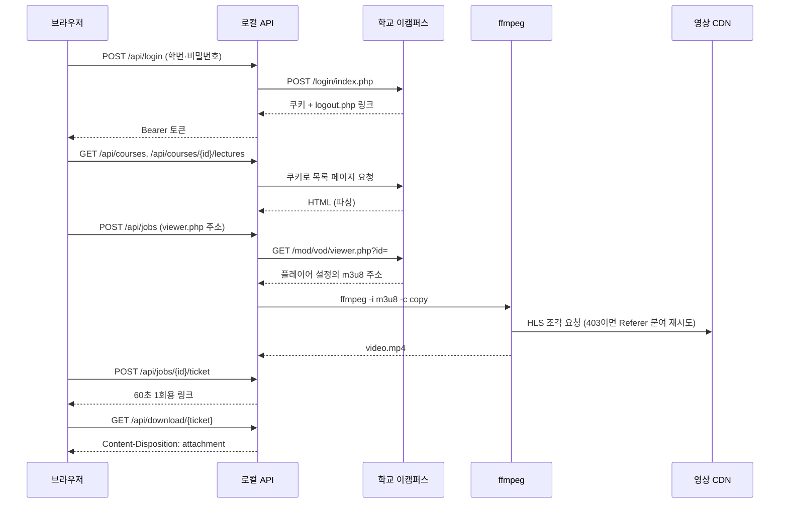
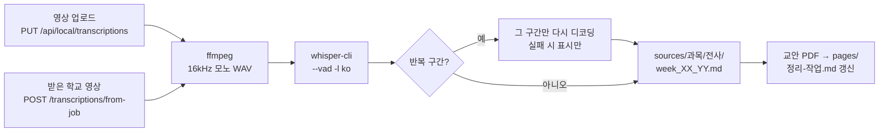

# 강의 서랍

세종대학교 집현캠퍼스 강의를 내려받고, 강의 영상을 이 컴퓨터에서 Whisper로 전사하고, 교안 PDF와 함께 AI 에이전트가 정리할 수 있게 입력을 준비하는 로컬 도구입니다.

- 웹 화면·Python 서버·Whisper 전사는 내 컴퓨터에서 실행됩니다. 시험 대비 정리는 선택한 로컬 에이전트 CLI를 통해 AI 서비스를 사용하며, 필요한 교안·전사 내용이 해당 서비스로 전송됩니다.
- 프론트엔드: React + Vite, 백엔드: FastAPI + ffmpeg. DB 없음.
- 학교 강의 받기: 학교 비밀번호는 저장하지 않으며, 사용자마다 별도의 학교 쿠키 세션을 메모리에 유지합니다. 영상은 서버 임시 폴더에서 `Content-Disposition: attachment`로 브라우저에 전달합니다.
- 전사·시험 정리: 영상을 올려 전사하고 `sources/강의이름/전사/`에 저장합니다. 올린 영상은 전사 후 지웁니다.

현재 구현 범위는 로그인·교과 과목/강의 목록 조회·영상 다운로드, Whisper 전사, 교안 준비, 로컬 에이전트를 통한 시험 대비 노트 생성입니다.

## 폴더 구조

```text
lecture-inbox/
├── client/        # React + Vite
├── server/        # FastAPI, 전사 파이프라인(server/lecture), 테스트, Python 의존성
├── scripts/       # 통합 개발 실행·설치·e2e
├── install.sh     # 한 줄 설치(Mac): 프로젝트 받기 + setup.sh
├── setup.sh       # 처음 설치(Mac)
├── 정리-지침.md    # AI 에이전트용 정리 지침
└── package.json   # npm workspace 및 통합 명령
```

## 로컬에서 실행

사용자에 맞는 항목을 펼쳐 보세요.

<details>
<summary><b>비개발자용 — 설치 한 줄로 실행하기 (Mac)</b></summary>

Windows는 지원하지 않습니다(`.venv/bin/python` 경로를 쓰므로 WSL이 필요합니다).

#### 시작 전에: 권장 사양

전사는 정확도가 가장 높은 Whisper **large-v3** 모델을 기본으로 씁니다(작성자 환경: M4 Pro, 메모리 48GB). 이 모델 기준 사양입니다.

| 항목 | 권장 | 최소 |
| --- | --- | --- |
| Mac | Apple Silicon (M1 이상) | Intel Mac도 실행되지만 전사가 매우 느립니다 |
| 메모리 | 16GB 이상 | 8GB (large-v3가 전사 중 약 4GB를 씁니다. 브라우저·AI 에이전트와 함께 쓰면 빠듯합니다) |
| 저장 공간 | 여유 10GB 이상 | 모델 약 3GB + 개발 도구·패키지 + 전사 중 영상 임시 파일 |
| macOS | 최신 버전 | Antigravity를 쓰려면 macOS 12 이상 |
| 인터넷 | 처음 설치(모델 3GB 포함)와 AI 정리에 필요 | 전사 자체는 오프라인으로 됩니다 |

사양이 낮으면 설치 중 경고가 나옵니다. 이때는 가벼운 모델을 받아 쓰세요: `npm run lecture -- models --size medium` 후 `WHISPER_MODEL=medium npm run dev` (정확도는 낮아집니다).

**AI 에이전트 계정** — 시험 대비 노트 정리에는 아래 중 **하나**의 계정이 필요합니다(전사만 할 거면 필요 없습니다). 설치 스크립트가 고르는 대로 설치하고 로그인까지 안내합니다.

| 에이전트 | 필요한 계정 | 직접 설치할 때 | 로그인 |
| --- | --- | --- | --- |
| Claude Code | Claude Pro/Max 등 Anthropic 계정 | `curl -fsSL https://claude.ai/install.sh \| bash` | `claude auth login` |
| Codex | ChatGPT 유료 요금제 계정 | `brew install --cask codex` | `codex login` |
| Antigravity | Google 계정 | `curl -fsSL https://antigravity.google/cli/install.sh \| bash` | `agy` 실행 후 안내대로 |

직접 설치했다면 터미널을 새로 연 뒤 로그인하세요.

#### 처음 한 번만: 설치 (명령 한 줄)

Node.js·Homebrew·git이 **없어도** 됩니다. 이미 설치돼 있으면 그대로 쓰고, 없는 것만 설치합니다.

1. **터미널 열기** — `⌘ + Space` → `터미널` → Enter
2. **설치 폴더를 둘 위치로 이동** — 예: `cd ~/Documents`
3. **아래 명령을 붙여 넣고 Enter**

   ```bash
   /bin/bash -c "$(curl -fsSL https://raw.githubusercontent.com/EM-H20/lecture-inbox/main/install.sh)"
   ```

   현재 위치에 `lecture-inbox` 폴더를 만들어 프로젝트를 받고, 안에서 `setup.sh`를 이어서 실행합니다. `setup.sh`가 하는 일은 이렇습니다.
   - Homebrew → Node.js(22.12 이상), Python(3.10 이상), ffmpeg, whisper-cpp 순서로 **없는 것만** 설치합니다. 시스템에 설치하기 전에는 항상 "설치할까요? (y/N)"로 먼저 묻습니다(`y` 입력 후 Enter).
   - 웹 화면 패키지와 Python 환경을 준비하고, `sources/`·`output/`·`models/` 폴더를 만듭니다.
   - 노트 정리에 쓸 AI 에이전트(Claude Code / Codex / Antigravity)를 하나 골라 설치하고 로그인할지 묻습니다. 이미 하나라도 있으면 건너뜁니다.
   - 사양을 확인해 권장보다 낮으면 알려 주고, Whisper 모델(large-v3, 약 3GB)을 받을지 묻습니다.

   | 내 Mac 상태 | 진행 |
   | --- | --- |
   | Homebrew·Node 둘 다 있음 | 둘 다 건너뛰고 Python·ffmpeg 등 빠진 것만 설치합니다. |
   | Node는 있고 Homebrew는 없음 | Homebrew를 설치한 뒤 이어서 진행합니다. 설치된 Node가 22.12보다 낮으면 brew로 새 버전을 설치합니다. |
   | 둘 다 없음 | Homebrew를 설치하고 Homebrew로 Node를 설치합니다. |

   **Homebrew가 없을 때** 설치 중에 이렇게 진행됩니다.
   - `Press RETURN/ENTER to continue`가 나오면 **Enter**를 누릅니다.
   - **Mac 비밀번호**를 묻습니다. 입력해도 화면에 안 보이는 게 정상입니다(관리자 계정이어야 합니다).
   - 개발자 도구 설치 창이 뜨면 **설치**를 누르고 끝날 때까지 기다립니다(몇 분).
   - 끝나면 스크립트가 알아서 이어서 진행합니다. 새 터미널에서도 `brew`를 쓰도록 `~/.zprofile`에 한 줄 추가할지 물어봅니다(`y` 권장).

   **중간에 실패하거나 멈췄다면** 같은 위치(예: `~/Documents`)에서 같은 명령을 다시 실행하세요. 이미 받은 폴더를 그대로 쓰고 끝난 단계는 건너뜁니다. 처음 실행에는 몇 분이 걸릴 수 있습니다.

   Node.js가 이미 있다면 `npx github:EM-H20/lecture-inbox`로도 같은 설치를 할 수 있습니다.

ZIP 파일로 받았다면 압축을 풀고 터미널에서 그 폴더로 이동한 뒤(`cd ` 다음에 폴더를 터미널 창으로 끌어다 놓고 Enter) `bash setup.sh`를 실행하면 같은 설치가 진행됩니다.

#### 실행

```bash
npm run dev
```

브라우저에서 http://127.0.0.1:4317 을 엽니다. 이 명령 하나로 웹 화면(4317)과 Python 백엔드(4318)가 함께 실행됩니다. 종료는 터미널에서 **Control+C**(둘 다 종료됩니다).

처음 설치가 끝나면 안내된 대로 `cd lecture-inbox`로 들어가서 실행하세요. 다음부터는 설치 없이 이 폴더로 이동한 뒤 `npm run dev`만 하면 됩니다. 전사·교안 정리는 아래 "강의 전사와 교안 정리" 항목을 보세요.

#### 문제 해결

| 증상 | 해결 |
| --- | --- |
| `command not found: npx` / `node` | 설치 직후라면 터미널을 닫고 새로 엽니다. 그래도 안 되면 설치 폴더에서 `bash setup.sh`를 다시 실행합니다. |
| `command not found: brew` | 설치 폴더에서 `bash setup.sh`를 다시 실행하세요. 그래도 안 되면 터미널을 닫고 새로 엽니다. |
| `먼저 npm run setup을 실행해 주세요.` | 프로젝트 폴더에서 `bash setup.sh`(또는 `npm run setup`)를 실행합니다. |
| `address already in use` (4317/4318) | 이전 `npm run dev`가 아직 실행 중입니다. 그 터미널에서 Control+C로 끄세요. |
| 화면은 뜨는데 영상 준비가 실패 | http://127.0.0.1:4318/api/health 에서 `"ffmpeg": true`인지 확인합니다. `false`면 `brew install ffmpeg`. |
| 모델을 나중에 받고 싶다 | `npm run lecture -- models` (더 가벼운 모델은 `--size small`) |
| ZIP을 다른 Mac에서 풀었는데 실행이 안 됨 | 그 PC에서 `bash setup.sh`를 다시 실행합니다(`.venv`·`node_modules`·모델은 PC마다 따로 만들어야 합니다). |

#### ZIP을 만들어 배포하는 사람에게

```bash
npm run zip
```

프로젝트 폴더 옆에 `lecture-inbox.zip`이 만들어집니다. 용량이 크거나 PC마다 다르거나 개인 자료인 것은 자동으로 뺍니다: `models/`, `output/`, `sources/`, `node_modules/`, `.venv/`, `.git/`, `.env`, `client/dist/`. 받는 사람은 위 "처음 한 번만: 설치"대로 하면 이 폴더들이 `bash setup.sh`로 만들어집니다.

</details>

<details>
<summary><b>개발자용 — git clone으로 개발하기</b></summary>

필요: Node.js 22.12 이상(또는 24), Python 3.10 이상, ffmpeg, git.

```bash
git clone <저장소 주소> lecture-inbox && cd lecture-inbox
brew install ffmpeg      # Node·Python이 없으면 brew install node python 도 함께
npm install              # client 워크스페이스 의존성
npm run setup            # .venv 생성 + server/requirements-dev.txt 설치
npm run dev              # 웹(4317) + API(4318) 동시 실행
```

| 명령 | 동작 |
| --- | --- |
| `npm run dev` | `scripts/dev.mjs`가 uvicorn(`127.0.0.1:4318`)과 Vite(`127.0.0.1:4317`)를 함께 실행. Control+C로 둘 다 종료 |
| `npm run dev:client` / `npm run dev:server` | 프론트엔드·백엔드를 각각 실행 |
| `npm run setup` | `.venv` 생성 및 Python 의존성 설치 (프로젝트 안에만 설치) |
| `npm test` | 백엔드 `unittest`와 클라이언트 테스트 실행 |
| `npm run e2e` | 임시 폴더에서 웹 + 서버 + **실제 Whisper**를 켜고, 영상을 올려 전사·저장을 확인한 뒤 전사 도중 종료해도 남는 프로세스가 없는지 확인. 모델(`npm run lecture -- models`)과 한국어 음성(`say`)이 필요하고, 켜 둔 `npm run dev`와 겹치지 않게 4417/4418 포트를 씀 |
| `npm run build` / `npm run preview` | 프론트엔드 빌드 / 빌드 결과 미리보기 |

- Vite가 `/api`를 로컬 백엔드로 프록시하므로 개발 중에는 환경변수가 필요 없습니다.
- 모든 구성이 로컬에서 실행됩니다. Docker는 필요 없습니다.
- 선택 설정은 환경변수로 지정합니다(`.env.example` 참고). 예: `WHISPER_MODEL=small npm run dev`. `.env` 파일은 자동으로 읽히지 않습니다.
- 서버 로그는 `npm run dev` 터미널에 출력됩니다. 로그인, 영상 준비·실패, 다운로드 시작을 작업 ID 앞 8자리와 함께 남기며, 학교 비밀번호·학번·다운로드 링크·ffmpeg stderr는 남기지 않습니다. 요청 단위 접근 로그(`--no-access-log`)는 다운로드 링크가 경로에 들어가므로 꺼 두었습니다.
- 로그는 `server/app.py`의 `uvicorn.error` 로거를 사용합니다. 새 로그도 이 로거로 남기면 같은 터미널에 나옵니다.

</details>

## 사용 방법

1. 화면에서 본인의 학번·학교 비밀번호로 로그인합니다.
2. 수강 과목을 선택합니다. 연도·학기 필터로 이전 학기 과목도 조회할 수 있습니다. 연도는 현재 연도부터 2003년까지 목록에서 고릅니다.
3. 강의 목록에서 **영상 준비**를 누릅니다. 한 강의 준비가 끝나야 다음 강의를 준비할 수 있습니다. 과목명·강의명으로 파일 이름을 만듭니다. **강의 주소로 직접 추가**에서는 기존처럼 `https://ecampus.sejong.ac.kr/mod/vod/viewer.php?id=...` 주소와 파일 이름을 입력할 수 있습니다.
4. 준비 완료 후 **다운로드**를 누릅니다. 실제 저장 완료 여부는 브라우저 다운로드 목록에서 확인합니다.
5. **목록에서 정리**는 서버 임시 파일만 삭제합니다. 이미 컴퓨터에 받은 파일은 삭제하지 않습니다.

학교 로그인·목록 조회·다운로드는 실제 계정으로 아직 검증하지 않았습니다. 목록은 원본 저장소의 교과 조회 페이지(`/local/ubion/user/index.php`)와 동영상 항목 구조를 기준으로 구현했으며, 비교과 목록 조회는 포함하지 않습니다. 조회 실패·학교 로그인 만료는 빈 목록과 구분해 안내합니다. 학교 세션 만료 안내만으로 준비된 파일을 삭제하지 않으며, 재연결 전 받을 파일은 먼저 다운로드하세요. 연결이 실패하면 학교 TLS/로그인 변경 여부를 확인해야 합니다. 인증서 검증을 끄거나 비밀번호를 소스에 넣지 마세요.

## 강의 전사와 교안 정리 (화면 / 명령줄)

영상·음성 파일을 이 컴퓨터에서 전사하고, 교안 PDF와 함께 AI 에이전트(Claude Code, Antigravity CLI, Codex CLI)가 정리할 수 있게 입력을 준비합니다. 앱은 AI API를 직접 호출하지 않고 설치된 CLI를 실행합니다. 각 CLI의 로그인·모델 설정·사용 한도가 적용됩니다.

**화면에서 하기** — `npm run dev`로 켜고 http://127.0.0.1:4317 에서 **전사·시험 정리** 탭을 엽니다. ① 강의를 고르거나 이름을 입력해 만들고 ② 교안 PDF를 올리고(선택, 여러 개를 한 번에 고를 수 있고 올린 교안은 목록에서 삭제할 수 있습니다) ③ 주차·차시를 정하고 ④ 영상을 끌어다 놓고 [전사 시작]을 누르면, 진행 상태가 표시되고 끝나면 `sources/강의이름/전사/`에 저장됩니다. 올린 영상은 전사 후 지워집니다. 이미 전사된 회차는 "덮어쓰기"를 체크해야만 다시 전사됩니다. **학교 강의 받기** 탭에서 영상을 받은 뒤 [전사하기]를 눌러 같은 방식으로 전사할 수도 있습니다. 끌 때는 터미널에서 Control+C(실행 중인 전사까지 함께 종료됩니다).

아래 명령줄 방법은 같은 일을 터미널에서 하는 방법입니다.

**폴더 구조** — 아래 폴더는 `bash setup.sh`(또는 `npm run setup`)가 만들어 줍니다. 직접 넣는 것은 교안 PDF(여러 개 가능)뿐이고 나머지는 자동으로 생깁니다.

```text
lecture-inbox/
├── sources/                      ← 에이전트가 읽는 재료 (교안 + 전사체)
│   └── 자료구조/                  ← 강의 이름 (폴더 이름 = --course 값)
│       ├── 교안/                  ← 내가 넣는 교안 PDF (여러 개, 파일 이름이 문서 이름)
│       │   ├── 1주차.pdf
│       │   └── 2주차 실습.pdf
│       ├── pages/                ← 자동 생성: 문서마다 쪽별 이미지·텍스트
│       │   └── 1주차/p001.png, p001.txt …
│       └── 전사/                  ← 자동 생성: 전사체
│           └── week_03_01.md     ← 타임스탬프 포함 전사체
├── output/                       ← 에이전트용 작업 목록과 에이전트가 만든 결과
│   └── 자료구조/
│       ├── 정리-작업.md           ← 자동 생성: 에이전트가 읽는 작업 목록
│       └── notes/
│           └── week_03_01.md     ← 에이전트가 쓰는 정리 노트
└── models/                       ← Whisper 모델 (자동으로 받음)
```

`week_03_01`은 3주차의 1번째 강의입니다. 강의 영상 파일은 어디에 두어도 되고, 전사 명령에 경로를 적어 주면 됩니다. `output/`과 `sources/`는 git에 올라가지 않습니다.

**한 번만 준비** (Mac, Apple Silicon 권장)

```bash
brew install whisper-cpp ffmpeg
npm run setup                          # PDF 처리 라이브러리 포함
npm run lecture -- models              # 기본 large-v3(가장 큰 모델)를 models/에 내려받습니다(수 GB)
```

기본 모델은 가장 정확한 `large-v3`입니다. 더 빠른 작은 모델을 쓰려면 `npm run lecture -- models --size small`로 받고 `WHISPER_MODEL=small npm run lecture -- …`처럼 실행합니다. 선택지는 `tiny`, `base`, `small`, `medium`, `large-v3`입니다.

**전사**

```bash
npm run lecture -- transcribe ~/Downloads/강의.mp4 --course 자료구조 --week 3 --session 1
```

`sources/자료구조/전사/week_03_01.md`(구간마다 시작 시각 `[00:21:05]` 포함)가 생깁니다. `week_03_01`은 3주차의 1번째 강의입니다. 이미 있으면 `--force` 없이는 덮어쓰지 않습니다.

**교안**

`sources/자료구조/교안/`에 PDF를 여러 개 넣고(화면에서는 한 번에 여러 개 선택) `npm run lecture -- prepare --course 자료구조`를 실행하면 `sources/자료구조/pages/<문서이름>/`에 페이지별 이미지와 텍스트가 만들어지고 `output/자료구조/정리-작업.md`가 갱신됩니다. 전사 명령도 교안이 있으면 같은 일을 자동으로 합니다.

**정리** — 이 폴더에서 쓰는 에이전트를 열고 이렇게 말합니다.

> output/자료구조/정리-작업.md대로 정리해줘

에이전트는 `정리-지침.md`를 읽고 `output/자료구조/notes/week_03_01.md`에 노트를 씁니다. `output/`과 `sources/`는 git에 올라가지 않습니다.

**웹에서 시험 대비 정리** — **전사·시험 정리 → 과목 선택** 후, **자료 준비**에서 교안과 영상을 추가합니다. 이미 전사했다면 **시험 대비 노트 만들기**의 회차 카드에서 원하는 회차를 체크하고 에이전트를 선택한 뒤 **선택한 N개 정리하기**를 누릅니다. **미정리 회차 전체 선택 / 선택 해제**도 가능합니다. 선택한 회차만 순서대로 처리하며 개념 정리·핵심 암기사항·예상문제와 해설·불확실한 내용을 노트에 담습니다. 화면에서 진행 회차와 저장 개수를 확인하고 취소할 수 있습니다. 완성된 노트는 **정리 노트 보기**에서 넓은 읽기 화면으로 엽니다. **핵심 훑기 → 교수님 강조 → 개념 읽기 → 문제로 확인**으로 공부하고(교수님이 “외우세요”, “시험에 안 내요”처럼 직접 말한 내용은 **교수님 강조**에 모으고, 항목을 누르면 그 강조가 속한 정리된 강의 내용(표·교안 이미지 포함)과 전사 원문이 펼쳐집니다. 강조 발언이 없는 회차와 이전에 만든 노트에는 이 모드가 없습니다), **전체 읽기**와 Markdown 저장도 가능합니다. 표·수식·교안 이미지를 표시하고 정답은 눌러서 확인합니다. 문제에 적은 답은 노트를 닫으면 사라집니다. 기존 노트도 지원하며, 제목·정답 구조를 구분할 수 없는 노트는 전체 읽기로 표시합니다. 교안 이미지를 처음 지원하는 서버 버전으로 업데이트한 경우 서버를 다시 시작해야 합니다.

**노트 수정과 교안 삽입** — 읽기 화면의 **노트 수정**에서 글을 고칩니다. 글에서 원하는 위치를 누르고 **교안 페이지 골라 넣기**로 PDF·페이지를 선택하면 원본 페이지를 이미지로 넣을 수 있습니다. 사진·도식의 설명도 함께 적을 수 있습니다. **미리보기 → 수정 내용 저장**으로 반영하며, 저장 전에는 기존 노트가 바뀌지 않습니다. 저장 실패나 다른 창의 수정과 충돌하면 입력 내용이 화면에 남고 **수정본 내려받기**로 보관할 수 있습니다. 페이지는 PDF 준비 때 만들어진 이미지를 사용하며, 사진 영역만 자르는 기능은 포함하지 않습니다. 편집·교안 목록 API를 처음 반영할 때는 서버를 다시 시작하세요.

| 에이전트 | 사전 로그인 | 실행 방식 |
| --- | --- | --- |
| Claude Code | `claude auth login` | 읽기 도구만 허용한 `claude --print`, JSON 결과 |
| Antigravity CLI | `agy` 실행 후 로그인 | `agy --mode plan --sandbox --print`, JSON 결과 |
| Codex CLI | `codex login` | `codex exec --sandbox read-only`, 최종 응답 파일 |

설치된 CLI만 선택할 수 있습니다. 설치 확인이 로그인 성공을 의미하지는 않습니다. 로그인·사용량·연결·CLI 버전 문제는 작업 실패로 안내합니다. Antigravity는 표준 입력을 읽지 않으므로 지시문을 `--print` 인자로 전달하며, 모델은 Antigravity 설정의 기본값을 씁니다.

정리는 한 번에 한 작업만 실행하고 에이전트 실행 한 번의 제한 시간은 30분입니다. 어느 에이전트든 같은 형식이 되도록 서버가 노트를 `정리-지침.md`의 ‘형식 검사’로 확인합니다. 통과하지 못하면 이유를 알려 주고 한 번 다시 쓰게 하며, 그래도 실패하면 저장하지 않습니다. 기존 노트는 덮어쓰지 않습니다. 실패·취소 시 이미 완성된 회차는 남고, 미완성 회차는 저장하지 않아 다시 시작할 수 있습니다. 서버를 종료하면 진행 중인 에이전트와 하위 프로세스도 종료됩니다. 작업 상태는 메모리에만 남지만 완성 노트는 재시작 후에도 표시됩니다. 내려받은 Markdown의 교안 이미지 상대경로는 프로젝트의 원래 `notes/` 위치를 기준으로 합니다.

## 동작 원리

브라우저 화면(React, 4317)은 모든 요청을 로컬 API(FastAPI, 4318)로 보내고, 학교 사이트·ffmpeg·Whisper·AI 에이전트 CLI는 로컬 API만 호출합니다. 학교 강의 받기 흐름은 [`docs/school-download-flow.html`](docs/school-download-flow.html)을 브라우저로 열면 다이어그램으로 볼 수 있습니다.



### 1. 로그인 (`server/school.py`, `server/app.py`)

1. 화면이 `POST /api/login`으로 학번·비밀번호를 보냅니다. 서버는 먼저 시도 횟수를 제한합니다(15분 동안 IP당 20회, 학번당 5회. 학번은 해시로만 셉니다).
2. 사용자마다 새 `SchoolSession`(쿠키 저장소)을 만들고, 학교 로그인 폼(`/login/index.php`, `ssoGubun=Login`, `type=popup_login`)에 학번·비밀번호를 POST합니다. 리다이렉트가 `https://ecampus.sejong.ac.kr` 밖으로 나가면 로그인 정보를 넘기지 않고 중단합니다.
3. 최종 주소가 로그인 페이지가 아니고 응답 HTML에 `logout.php` 링크가 있으면 성공으로 판정합니다.
4. 서버가 임의 토큰을 만들어 `{학교 쿠키 세션, 만료 시각(2시간)}`을 메모리에 묶어 두고 토큰만 돌려줍니다. 화면은 토큰을 탭의 `sessionStorage`에 두고 이후 요청에 `Authorization: Bearer`로 붙입니다. 비밀번호는 이 요청에서만 쓰고 어디에도 저장하지 않습니다.

### 2. 과목·강의 목록

- `GET /api/courses?year=&semester=` → 학교 쿠키로 `/local/ubion/user/index.php`를 읽고 `a.coursefullname` 링크(`/course/view.php?id=숫자`)와 같은 행의 연도·학기 칸을 뽑습니다.
- `GET /api/courses/{id}/lectures` → `/course/view.php?id=`에서 `li.activity.vod`(id `module-숫자`) 항목의 강의 이름을 뽑아 `viewer.php?id=숫자` 주소를 만듭니다.
- 학교가 로그인 페이지로 돌려보내거나 `logout.php` 링크가 없으면 "학교 로그인 만료"(409)로 빈 목록과 구분해 알립니다. 학교 응답을 기다리는 동안 로그아웃했다면 응답을 버립니다.

### 3. 영상 받아 오기

1. **영상 준비**를 누르면 `POST /api/jobs`가 `viewer.php?id=숫자` 주소를 검증하고 작업을 큐에 넣은 뒤 바로 202를 돌려줍니다. 사용자당 진행 중 1개·보관 3개, 서버 전체 12개까지이고 디스크 여유도 확인합니다. 화면은 3초마다 `GET /api/jobs`로 상태를 확인합니다.
2. 백그라운드 스레드가 학교 쿠키로 `/mod/vod/viewer.php?id=`를 열고, `<video data-setup-lazy='{"sources":{"src":"…m3u8"}}'>`에서 HLS 재생 목록 주소를 꺼냅니다. 없으면 HTML에서 `https://…index.m3u8` 패턴을 찾습니다.
3. 그 주소가 HTTPS이고, DNS로 확인한 IP가 모두 공인 주소일 때만 진행합니다(내부망 주소 차단).
4. `ffmpeg -i <m3u8> -c copy -f mp4`로 HLS 조각을 **재인코딩 없이** 하나의 MP4로 합칩니다. ffmpeg에는 학교 쿠키를 넘기지 않으며, TLS 인증서 검증을 켜고 `https,tls,tcp,crypto` 프로토콜만 허용합니다. 최대 2GB·2시간이고, CDN이 403을 주면 `Referer: https://ecampus.sejong.ac.kr/`를 붙여 한 번 더 시도합니다.
5. `video.part`가 정상 크기면 `video.mp4`로 바꾸고 상태를 `ready`로 바꿉니다. 파일은 30분 보관합니다. ffmpeg 오류 출력에는 서명된 주소가 있을 수 있어 화면·로그로 내보내지 않습니다.

### 4. 브라우저로 내려받기

1. **다운로드**를 누르면 `POST /api/jobs/{id}/ticket`이 본인 작업인지 확인한 뒤 60초짜리 1회용 경로 `/api/download/{ticket}`을 줍니다.
2. 화면이 그 경로로 링크를 눌러 내려받습니다. 브라우저 다운로드에는 `Authorization` 헤더를 붙일 수 없어서 토큰 대신 1회용 티켓을 씁니다. 티켓은 한 번 쓰면 사라지고, 로그인이 만료됐으면 거부합니다.
3. 서버는 `Content-Disposition: attachment`로 파일을 보냅니다. 전송 중에는 파일을 지우지 않고, 전송이 끝나거나 끊긴 뒤 만료·삭제된 작업이면 정리합니다.

### 5. 전사 (`server/lecture/`)



- 업로드는 받기 전에 같은 회차 전사가 이미 있는지 먼저 확인합니다(덮어쓰기 체크가 없으면 거부). 학교 탭에서 받은 영상은 서버 임시 파일을 그대로 쓰고, 전사가 끝날 때까지 지우지 않습니다.
- 소리를 16kHz 모노 WAV로 바꾸되 무음은 자르지 않아 타임스탬프가 원본 영상과 맞습니다. Whisper가 같은 문장을 되풀이하는 구간을 찾으면 그 부분만 잘라 다시 디코딩하고(그래도 반복되면 디코딩 설정을 바꿔 한 번 더), 끝내 안 되면 그 구간을 표시만 해 둡니다.
- 저장 후 교안 PDF를 쪽별 이미지·텍스트로 만들고 `output/과목/정리-작업.md`를 갱신합니다. 업로드한 영상은 전사 후 지웁니다.

### 6. 시험 대비 노트 생성

1. **선택한 N개 정리하기** → `POST /api/local/courses/{과목}/study`. 한 번에 한 작업만 실행하며 고른 회차를 순서대로 처리합니다.
2. 회차마다 지시문을 만들어 선택한 CLI를 읽기 전용으로 실행합니다(`claude --print`, `agy --mode plan --sandbox --print`, `codex exec --sandbox read-only`). 에이전트가 교안·전사를 읽고 임시 폴더에 노트를 씁니다.
3. 서버가 `정리-지침.md`의 형식 검사로 노트를 확인합니다. 실패하면 이유를 지시문에 넣어 한 번 다시 쓰게 하고, 그래도 실패하면 저장하지 않습니다.
4. 통과한 노트는 `output/과목/notes/week_XX_YY.md`로 원자적으로 게시합니다. 다시 만들기를 고르면 기존 노트를 `notes/.history/`로 옮겨 보관합니다.

`/api/local/*` 경로는 `Host`가 로컬 주소인 요청만 받고, 쓰기 요청(POST·PUT·DELETE)에는 화면이 붙이는 확인 헤더가 있어야 합니다.

## 세션·보관 동작

- 애플리케이션 세션은 기본 2시간, 준비된 파일은 기본 30분 유지됩니다. 학교 세션이 더 먼저 만료될 수 있습니다.
- 학교 비밀번호는 로그인 요청에서만 사용합니다. API 세션 토큰은 브라우저의 해당 탭 `sessionStorage`에, 학교 쿠키는 서버 메모리에만 있습니다.
- 사용자별 파일 소유권을 확인한 후 60초·1회용 다운로드 링크를 발급합니다. 링크를 공유하지 마세요.
- 로그아웃은 세션과 발급된 링크를 무효화합니다. 진행 중인 서버 작업은 취소하고, 이미 전송 중인 파일은 전송이 끝난 후 정리합니다.
- 서버 재시작 시 로그인과 작업 기록은 사라집니다. 학교 계정으로 다시 로그인해야 합니다.
- DB 없는 단일 API 프로세스용 구현입니다. `uvicorn --workers 1`을 유지하세요. 프로세스 잠금이 같은 컴퓨터에서 서버를 두 번 켜는 것을 막습니다.
- 원본 레포의 낮은 TLS 보안 수준 호환 어댑터는 포함하지 않았습니다. 학교와 CDN 모두 정상 인증서 검증을 유지합니다.
- Whisper 전사에는 요약·화자 분리가 없습니다. 시험 대비 요약은 별도의 에이전트 정리 작업입니다.

## 검증

```bash
npm test        # 백엔드 + 클라이언트 테스트
npm run build   # 프론트엔드 빌드
npm run e2e     # 실제 Whisper까지 포함한 전체 흐름 (모델 필요)
```

테스트에서는 학교 로그인과 CDN을 모의 처리합니다. 과목·강의 HTML 파싱, 필터 검증, 사용자별 목록 세션, 조회 중 로그아웃, 학교 만료 응답, 선택한 강의의 다운로드 작업 연결, 두 사용자 간 격리, 비밀번호 오류 응답 비노출, 로그인 시도 제한, 1회용 링크, 만료/로그아웃 후 접근 차단, 전송 중 정리, 403 Referer 재시도, 불완전 파일 정리를 검증합니다.
모의 API를 연결한 브라우저에서 과목 선택·영상 준비 요청, 과목 변경 시 오래된 응답 무시, 오류 후 재시도, 빈 목록, 모바일·데스크톱 화면을 확인했습니다. 실제 학교 로그인/영상 다운로드는 별도 검증이 필요합니다.

## 참고한 코드

- [chuseok22-home-server downloader.py](https://github.com/Chuseok22/chuseok22-home-server/blob/main/apps/sejong/lecture/services/downloader.py): HLS → MP4 무재인코딩 저장 및 Referer 재시도 흐름
- [ecampus_auth.py](https://github.com/Chuseok22/chuseok22-home-server/blob/main/apps/sejong/lecture/services/ecampus_auth.py): 학교 로그인 폼과 로그인 성공 판정
- [course.py](https://github.com/Chuseok22/chuseok22-home-server/blob/main/apps/sejong/lecture/services/course.py): 교과 과목·동영상 목록 파싱, 목록 페이지의 로그인 만료 판정, 플레이어 설정의 `sources.src` 추출 방식

위 흐름을 별도의 FastAPI 서비스로 구현했습니다. 원본 Django 서버 전체나 PostgreSQL을 실행하지 않습니다.
