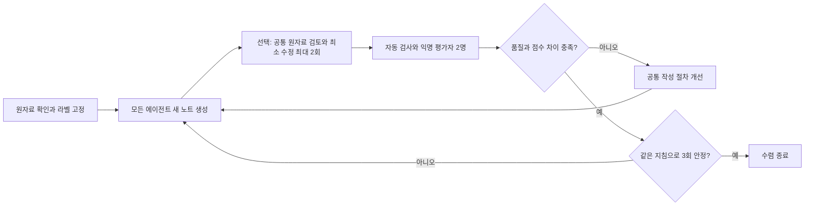

# 강의 노트 신뢰도 평가와 반복 실험

이 문서는 에이전트가 달라도 같은 사실·단위·불확실성을 보존하는지 평가하는 절차를 정한다. 문장 일치는 목표가 아니다. 원자료와 평가 기준을 고정하고, 자동 검사와 내용 검수를 나누어 결과를 비교한다. `evaluation`은 형식·이미지 경로·전사 시각을 검사한다. `improvement`는 고정 라벨과 두 모델 평가자를 사용해 생성·평가·공통 지침 개선을 반복한다. 모델 판정 자체의 정확성은 별도 검수가 필요하다.

자동 검사 프로토콜은 `note-reliability-v2`다. v2는 자릿수가 잘못된 세 부분 시각도 인용 횟수와 오류에 포함한다. 이전 대화의 A/B/C 종합 점수는 초기 수동 평가 결과로 보존한다. 사실 분할과 인용 배점을 정제한 이 프로토콜의 점수와 직접 비교하지 않는다. 기존 세 노트는 이미 확인했으므로 개발 사례이며, 독립적인 검증 자료로 다시 분류하지 않는다.

반복 개선 실행의 현재 버전은 `note-improvement-v5`다. 첫 시험 실행에서 복합 사실과 복수 출처의 지원 관계에 대한 채점 차이가 발견되어 사실 라벨을 60개로 분리하고 판정 경계를 고정했다. 두 평가자가 실제 PNG를 보고 수행한 양성·음성 경계 사례 4개는 모두 일치했다. v2에서 전역 스킬 읽기와 잘못된 시각 자릿수의 검사 누락이 발견되어 v3에서는 실행 경계와 자동 검사를 수정했다. v4는 정답표를 받지 않는 공통 원자료 검토·최소 수정 단계를 선택적으로 추가했고, v5는 용어 교정표의 전사 표현과 인용 구간을 문자열로 대조한 보조 정보를 검토자에게 제공한다. v1·v2는 진단 기록이며 수렴 증거로 사용하지 않는다. 실행 코드와 검사기 해시도 고정해 변경 후 같은 실험을 재개하지 못하게 한다. 작은 경계 사례의 통과는 이후 긴 노트에서의 판정 일치까지 보장하지 않는다.

## 연구에서 채택한 방법

| 자료 | 확인한 방법 | 이 프로젝트의 적용 |
| --- | --- | --- |
| [FActScore 논문](https://arxiv.org/abs/2305.14251) · [구현](https://github.com/shmsw25/FActScore) | 생성문을 개별 사실로 나누고 신뢰할 자료가 뒷받침하는 비율을 평가 | 한 항목에 여러 사실을 묶지 않는다. 정확성과 필수 내용의 누락을 별도로 센다. |
| [ALCE 논문](https://arxiv.org/abs/2305.14627) · [구현](https://github.com/princeton-nlp/ALCE) | 정답성 외에 인용의 지원 여부와 포괄성을 평가 | 실제 시각·쪽이 있다는 것과 그 근거가 주장을 뒷받침한다는 것을 구분한다. |
| [LLM 심사자 연구](https://arxiv.org/abs/2306.05685) | 위치·장황함·자기 선호 등 심사 편향을 분석 | 작성자를 숨기고 항목별 근거로 채점한다. 상대 비교를 쓰면 제시 순서를 바꾸어 확인한다. |
| [Self-Refine 논문](https://arxiv.org/abs/2303.17651) · [구현](https://github.com/madaan/self-refine) | 생성한 결과에 피드백을 주고 다시 개선하는 반복 구조 | 오류 이유를 다음 개선에 전달하는 구조를 참고한다. 여기서는 고정 라벨·자동 검사·독립 평가자 둘을 함께 사용한다. |
| [GEPA 논문](https://arxiv.org/abs/2507.19457) · [구현](https://github.com/gepa-ai/gepa) | 실행 기록과 자연어 피드백으로 프롬프트를 수정하고 여러 후보의 성과를 평가 | 총점뿐 아니라 실패한 항목·출처·실행 기록을 공통 절차 개선의 입력으로 삼는다. 현재 실행기는 GEPA의 후보 탐색 알고리즘을 구현하거나 패키지를 도입한 것은 아니다. |

위 연구를 한국어 강의 전사와 PNG 교안 평가에 적용하는 것은 프로젝트 설계 판단이다. 해당 논문이 이 자료·언어·평가 점수의 타당성을 검증한 것은 아니다. 외부 검색은 평가 방법 조사에만 사용하며, 강의 노트의 정답 근거로 사용하지 않는다.

## 찾은 스킬과 공개 저장소

- [LangChain eval-engineering](https://github.com/langchain-ai/langchain-skills/blob/main/config/skills/eval-engineering/SKILL.md): 실행 조건·환경·검사기를 구분하고, 판별 가능한 항목은 코드로 검사하며, 의미 판단은 별도 검수하는 설계에 참고했다. Harbor 기반 실행 체계 전체는 현재 저장소에 도입하지 않았다.
- [wshobson llm-evaluation](https://skills.sh/wshobson/agents/llm-evaluation): 일반적인 평가·기준선·실험 설계의 스킬 후보다. 소개와 검색 결과를 확인했으며, 전체 지침 검수나 설치를 완료한 것으로 취급하지 않는다.
- [skill-eval-loop](https://github.com/jon-devlapaz/skill-eval-loop): 동일 실행 도구에서 지침 유무를 비교하고 실행 기록·해시·반복 결과를 보관하는 구현을 참고했다. 기존 생성기를 교체하거나 이 저장소의 효과가 검증되었다고 간주하지 않는다.

현재 구현에는 외부 평가 패키지나 새 스킬 설치가 필요하지 않다. 검색 결과의 다운로드 수나 모델 순위는 도입 근거로 사용하지 않는다.

## 원자료와 작성자 기록

실험 관리자는 회차별 전사체·교안 PNG·정리 지침·생성 프롬프트·검사기·출력 파일의 SHA-256을 기록한다. 작성 에이전트, 정확한 모델 버전, 설정, 도구 권한, 실행 순서, 소요 시간, 재시도 및 실패도 별도 기록한다. 확인하지 못한 값은 `null`로 두며 문체나 CLI 이름만으로 모델을 추정하지 않는다.

작성자 매핑과 생성 프롬프트는 채점자에게 제공하지 않는다. 채점자는 익명 후보 ID, 노트, 원자료, 확정된 라벨과 검사 결과만 받는다. 정답 라벨과 다른 후보의 노트는 생성 에이전트에게 제공하지 않는다. 전역 스킬·메모리·기존 노트 접근도 실행 조건에 포함한다. 같은 프롬프트라도 도구·메모리 조건이 다르면 동일한 실험 조건이 아니다.

이 프로젝트의 CLI 출력은 입력 순서에 따라 `N001`, `N002` 등을 부여하고 노트의 해시를 기록한다. 파일명은 출력하지 않는다. 무작위 제시 순서와 작성자 매핑은 실험 관리자가 별도로 관리한다. 해시만으로 작성자를 추론하지 않는다.

## 노트를 보기 전에 고정할 정답 라벨

전사 전체를 읽고 관련 PNG를 직접 확인한 뒤 라벨을 만든다. TXT는 쪽 탐색에만 쓴다. 각 라벨에는 다음을 기록한다.

| 필드 | 내용 |
| --- | --- |
| ID와 종류 | 사실 또는 판단 함정 |
| 단일 주장 | 예: 한 샷 원두 사용량은 7±1 g |
| 근거 | 교안 문서·쪽과 PNG 확인 여부, 실제 전사 시작 시각 |
| 인정할 표현 | 예: 6–8 g, 단위의 동등한 표기 |
| 불인정할 표현 | 예: 단위 누락, 추출량과 원두량의 혼동 |
| 필수 여부 | 해당 회차가 실제 다루었고 보존해야 하는 내용인지 |
| 충돌 처리 | 원자료 양쪽 표현, 본문 인접 경고 필요 여부, 정답으로 확정하면 안 되는 값 |

“9기압 이상에서 크레마가 생기며 구조가 단순하고 유지 관리가 쉽다”는 세 사실로 분리한다. 숫자의 의미를 구성하는 단위·조건은 같은 사실에 둔다. 선택적인 예시의 모든 표현을 재현하지 않았다는 이유로 핵심 개념 전체를 0점 처리하지 않는다.

교안의 명칭을 그대로 보존한 것과 그 명칭을 오탈자로 의심하는 것은 다르다. 발음·전사와 영문 표기가 다르다는 이유만으로 오탈자 의심 표시를 의무화하지 않는다. 반면 제공 자료에 없는 철자로 바꾸었다면 실제 세계의 정답 여부와 별개로 근거 없는 변경이다. 이 구분은 초기 A/B/C 평가의 명칭 관련 판단을 정제한 것이다.

라벨에는 짧은 정답, 올바른 바꿔쓰기, 그럴듯한 오답, 경계 사례를 하나씩 붙여 채점 기준을 시험한다. 평가자가 달리 판단하면 원자료로 판정하고 이유를 남긴다. 확정 이후 변경은 새 버전으로 만들고 모든 후보에 동일하게 재적용한다.

## 점수와 판정

| 항목 | 배점 | 계산과 조건 |
| --- | ---: | --- |
| 필수 사실 보존 | 40 | 정확히 보존한 필수 사실 수 / 확정된 필수 사실 수 |
| 판단 함정 | 30 | 올바르게 처리한 함정 수 / 확정된 함정 수. 각 항목의 필수 조건을 미리 고정 |
| 시각 실재 | 5 | 실제 발언 시작 시각인 인용 수 / 전체 시각 인용 수 |
| 인용 지원 | 10 | 근거 묶음이 실제로 뒷받침하는 주장과 출처 묶음의 조합 / 전체 조합. 동일 조합의 반복은 한 번 |
| 근거 포괄성 | 5 | 적절한 근거가 붙은 제시된 필수 사실 수 / 제시된 필수 사실 수 |
| 내용 오류 | 10 | `max(0, 10 - 2.5 × 독립적인 오류 수)` |

노트가 필요한 사실이나 인용을 하나도 제시하지 않은 경우 해당 항목은 0점이다. 원자료나 라벨이 없어 분모를 결정할 수 없는 경우는 `not_evaluated`이며 총점을 계산하지 않는다. 의미 검수가 없으면 시각 실재율이 100%여도 신뢰도 100점으로 보고하지 않는다.

같은 원인과 같은 잘못된 주장의 반복은 내용 오류 한 건으로 센다. 단순 누락은 사실 보존 점수에서 처리한다. 없는 시각 자체는 시각 점수에서 처리하고 내용 오류로 다시 세지 않는다. 실제로 전혀 다른 주제의 구간을 근거로 제시한 경우에는 별도의 출처 오류가 될 수 있으며, 그 의미상의 차이를 기록해야 한다.

교안이 수치 표를, 전사가 단위 채점 설명을 지원한다면 둘을 함께 인용한 문단은 지원된다. 각 출처가 문단의 모든 문장을 각각 포함해야 한다고 요구하지 않는다. 반면 “교안에 시험 채점 설명이 있다”처럼 특정 출처로 명시적으로 잘못 귀속하면 출처 오류다. 값·개념의 사실 보존은 불확실성 경고 처리와 별개로 판정하고, 경고 누락만으로 사실 점수까지 잃게 하지 않는다.

교안·전사 충돌이 해소되지 않았는데 확정 정답으로 제시한 경우, 존재하지 않는 출처, 자료 밖 사실은 별도로 중대 오류로 표시한다. 중대 오류 유무와 자동 검사 통과 여부를 총점 옆에 함께 보고한다. 문장의 길이·말투·작성자 선호는 채점하지 않는다.

시각은 메타데이터의 `HH:MM:SS`와 본문의 `[HH:MM:SS]`를 센다. `[00:30:5]` 같은 세 부분 시각도 분모와 오류에 포함하며 자릿수를 자동 보정하지 않는다. 반복과 범위 양끝은 각각 한 번, 코드 블록과 인용 표기가 아닌 일반 시각은 제외한다. 원자료에 같은 시작 시각이 반복되어도 존재 여부는 집합으로 확인한다. 시작과 끝이 모두 존재해도 범위가 역전되면 검사 실패다.

현재 자동 검사에는 문항 유형의 의미, 교안 인용 쪽의 지원 여부, PNG를 실제 열었는지, 이미지 캡션의 정확성, 고유명사·단위 충돌의 처리가 포함되지 않는다. 별도 내용 검수와 실행 기록 확인이 필요하다. 수동 편집 저장에는 생성용 검사를 강제하지 않는다.

## 검사 명령

아래 명령은 명시한 세 노트와 전사체만 읽고, 표준 출력으로 결과를 반환한다. 이미지 검사는 노트의 최종 저장 위치인 `output/<강의>/notes/`를 기준으로 한다. 파일을 고치거나 모델을 호출하지 않는다.

```bash
.venv/bin/python -m server.lecture.evaluation \
  --course 바리스타 \
  --transcript sources/바리스타/전사/week_02_01.md \
  --notes output/바리스타/eval/note_A.md \
          output/바리스타/eval/note_B.md \
          output/바리스타/eval/note_C.md
```

종료 코드 0은 기계적 검사 통과, 1은 노트 검사 실패, 2는 입력·실행 실패다. 입력 실패를 모델의 내용 오류로 계산하지 않는다. 결과의 `semantic_status`는 현재 항상 `not_evaluated`, `reliability_score`는 `null`이다.

생성 시에는 세 에이전트 모두 같은 검사 함수를 거친다. 실패 사유를 넣어 한 번 재작성하고, 계속 실패하면 저장하지 않는다. 기존 노트를 다시 생성하는 경우에도 검사 실패 시 기존 파일을 보존한다.

## 일반화 실험

1. 현재 세 노트는 개발 사례로 고정하고 원본을 보존한다. 원래 생성 설정을 모르면 동일 조건의 모델 비교라고 주장하지 않는다.
2. 아직 평가하지 않은 다른 회차를 검증용으로 선택한다. 가능하면 과목도 바꾸고 수치·그림·충돌·전사 전용 설명이 있는 사례를 포함한다. 그 회차의 정답 라벨부터 확정한다.
3. 각 에이전트에서 기존 방식과 개선 방식을 같은 원자료·모델·도구 조건으로 각 3회 실행한다. 시작 순서는 번갈아 배치한다. 프롬프트와 검사기를 동시에 바꾸면 효과를 분리할 수 없으므로 한 실험에서는 한 요소만 바꾼다.
4. 최초 응답과 재작성 후 응답을 모두 보관한다. 최종 결과만 보면 자동 검사가 잡아낸 최초 오류와 재작성 비용이 숨겨진다. 시간 초과·인프라 실패·검사기 오판은 내용 실패와 구분한다.
5. 익명으로 채점하고 동일 사례에서의 기존 대비 변화, 중대 오류 발생률, 사실 누락률, 평균·최저·편차, 재시도·시간·비용을 보고한다. 개발 회차만 좋아졌다면 일반화 성공으로 결론 내리지 않는다.
6. 검증 자료의 답을 확인한 뒤 지침을 수정했다면 그 자료는 개발 자료로 이동한다. 새 검증 자료에서 다시 확인한다. 모든 채점과 이견 조정이 끝난 뒤 작성자 매핑을 공개한다.

이 문서와 검사기의 추가는 일반화 효과의 증명이 아니다. 실제 모델의 새 반복 실행과 독립적인 내용 검수가 완료되어야 효과를 보고할 수 있다.

## 반복 개선 실행

`server.lecture.improvement`는 기존 웹 생성·저장 흐름과 분리된 실험 명령이다. 원래 노트와 전사·교안을 수정하지 않는다. 원자료의 복사본, 고정된 라벨, 지침 버전, 각 최초 응답과 평가·개선 호출을 실험 폴더에 보관한다. 실험 결과를 기존 노트로 자동 게시하지 않는다.



기본 종료 기준은 아래 조건을 **모두** 충족하는 것이다. 경험적으로 검증된 보편 임계값이 아니라 이번 실험의 사전 설정이다.

| 조건 | 기본값 |
| --- | --- |
| 모든 후보의 총점 | 90점 이상 |
| 사실·함정·인용·오류 각 항목을 100점으로 환산한 점수 | 80점 이상 |
| 에이전트 간 총점 차이 / 항목별 차이 | 3점 이하 / 5%p 이하 |
| 같은 지침으로 확인할 새 생성 횟수 | 연속 3회 |
| 확인 구간에서 각 에이전트의 최대–최소 총점 / 항목별 점수 | 1점 이하 / 3%p 이하 |
| 같은 노트에 대한 두 평가자의 총점 차이 / 항목별 차이 | 3점 이하 / 5%p 이하 |
| 중대 내용 오류 / 형식·시각 오류 / 지침 위반 | 모두 0건 |
| 최대 반복 / 개별 호출 제한 | 8회 / 20분 |

낮은 점수에서 정체된 경우는 성공이 아니다. `converged`만 종료 코드 0이며 `max_rounds`와 `stalled`는 미수렴 종료 코드 1이다. 입력·평가 형식·CLI 실패는 `execution_failed`, 종료 코드 2이며 점수로 바꾸지 않는다. 중단된 실험은 같은 고정 입력으로 재개할 수 있다. 이미 완료한 후보의 해시를 확인하고 재사용하며, 개선 단계가 중단되었으면 그 단계부터 마친다. 동시에 같은 실험을 두 번 실행할 수 없다.

라벨 JSON은 `version`, `reviewed: true`, `transcript_sha256`, `scope_pages`, `allowed_pages`, `facts`, `traps`를 가진다. 각 사실·함정에는 `id`, `claim`, `accept`, 실제 `timestamps`, PNG `pages`를 넣는다. `reviewed`는 라벨 작성자가 전사 전체와 해당 PNG를 직접 검수한 후에만 설정한다. 제공 예시는 이번 회차의 개발용 라벨이며 새 회차에는 새 라벨을 먼저 작성한다.

```bash
.venv/bin/python -m server.lecture.improvement \
  --course 바리스타 \
  --transcript sources/바리스타/전사/week_02_01.md \
  --rubric output/바리스타/evaluation-runs/rubrics/week_02_01-v2.json \
  --output output/바리스타/evaluation-runs/새-실험-이름 \
  --agents codex claude --judges codex claude --source-review

.venv/bin/python -m server.lecture.improvement \
  --resume output/바리스타/evaluation-runs/새-실험-이름
```

첫 명령은 실제 모델을 호출하고 계정 사용량을 소비한다. 종료 기준 옵션은 `--min-score`, `--agent-gap`, `--score-delta`, `--component-floor`, `--component-gap`, `--component-delta`, `--judge-gap`, `--window`, `--max-rounds`, `--timeout`이다. 재개에서는 저장한 설정만 사용한다. 설정·정답 라벨·원자료를 바꾸려면 새 실험을 만든다.

`--source-review`는 모든 생성기의 초안에 같은 검토자를 적용한다. 검토자는 `--judges`의 첫 에이전트이며 위 명령에서는 Codex다. 매번 새 작업 문맥에서 원자료·기본 지침·공통 절차·노트 한 개만 보고, 정답 라벨·채점 결과·작성자·다른 후보는 받지 않는다. 최대 두 번 검토하며 수정안이 없으면 일찍 끝낸다. 원문이 정확히 한 곳에 있는 수정만 허용하고 겹치는 수정은 거부한다. 수정 범위 밖 텍스트를 보존한 뒤 기존 자동 검사와 두 평가자의 독립 채점을 적용한다. 이 모드의 수렴은 공통 검토·수정 단계를 포함한 워크플로의 결과이며, 작성기 자체의 단독 성능과 구분해야 한다. 검토자의 오판이나 두 번 이후 남은 오류는 최종 평가에서 계속 실패 사유가 된다.

원자료 검토 때 `transcript-quote-hints.json`도 제공한다. 이 파일은 `본문 표기 | 전사 표현 | 근거` 표에서 각 전사 표현이 그 행의 인용 구간에 실제 문자열로 나타나는지 확인하고, 찾지 못하면 전사 전체에서 일치하는 시작 시각을 탐색해 보여준다. 시간 범위, 같은 시작 시각의 여러 발언, 한글 정규화를 처리하며 코드 블록의 표는 제외한다. 정답표나 기존 점수는 사용하지 않는다. 바꿔쓰기와 표 안의 설명도 경고 대상이 될 수 있어 자동 감점이나 자동 수정에는 사용하지 않는다. 검토자가 원문과 의미를 확인해야 하며, 빈 목록도 인용 정확성의 증명이 아니다. 검토마다 현재 노트에서 다시 계산하고 `quote-hints-NNN.json`과 해시를 보존한다. 수정안에는 적용을 확정한 변경만 넣도록 요구하지만 이는 모델의 의미 판단을 보증하는 코드 검사가 아니다. 실제 시험에서 검토가 올바른 표기를 잠시 훼손한 사례도 있어 최초 초안·중간 수정·최종 독립 평가를 함께 확인해야 한다.

생성기는 원자료·기본 지침·공통 개선 절차만 받는다. 평가자는 원자료·고정 라벨·익명 노트 한 개만 받고, 작성자·이전 점수·다른 후보를 받지 않는다. 판정은 항목 ID별 통과 여부와 노트 줄·이유를 포함하며, 점수는 코드가 계산한다. 두 평가자의 낮은 총점을 사용하고, 어느 평가자든 보고한 중대 오류와 지침 위반은 종료를 막는다. 추가 작성 절차는 두 번째 평가자가 정답 유출·특정 에이전트 공략·기존 요구 완화 여부를 검수한 후 모든 생성 에이전트에 동일하게 적용한다. 지침을 바꿀 때 확인 구간을 다시 센다.

`report.md`는 사람이 읽는 결과, `state.json`은 재개 상태, `config.json`은 기준·입력 해시·평가 규칙 해시·CLI 버전이다. `round-NNN/Nxxx/`에는 최초 `draft.md`, 최종 `candidate.md`, 자동 검사·두 평가자의 근거와 각 호출의 프롬프트·명령·원시 이벤트·오류 출력·소요 시간이 있다. 원자료 검토를 사용하면 `source-pass-NNN.json`에 수정 제안과 입력·출력 해시를 보존한다. 재개할 때 초안과 완료된 검토를 검증해 재사용한다. 작성자 매핑은 `private-mapping.json`에 따로 남는다. CLI 기본 모델은 추정하지 않으며 확인되지 않은 모델 이름은 `null`이다. 스트림에서 확인된 모델과 사용량은 `observed_models`, `usage_records`로 별도 기록한다.

작업 폴더 복사와 읽기 전용 도구는 원본 보호 수단이다. Codex는 `skills.include_instructions=false`로 스킬 안내 주입을 끄고 평가 자료 제한을 developer 지침으로 전달한다. 플러그인·훅·메모리·추가 에이전트 실행을 끄며 평가 범위 PNG를 이미지 입력으로 제공한다. `project_doc_max_bytes=0`만으로 전역 AGENTS.md 주입이 없어지는 것은 아니다. 전역 지침이 문맥에 남을 수 있으므로 호스트 지침까지 제거한 완전 격리라고 주장하지 않는다. 로컬 `codex debug prompt-input`으로 실제 안내 주입 여부를 확인했다. [Codex 설정 스키마](https://github.com/openai/codex/blob/main/codex-rs/core/config.schema.json)는 스킬 안내와 developer 지침을 별도 설정으로 정의한다.

Claude는 safe/restricted 모드와 파일 읽기 도구를 사용한다. Antigravity에는 비대화형 모드에서 셸을 사용할 수 없음을 명시한다. `trace-audit.json`은 관찰된 자료 밖 접근을 거부하고, 평가 범위 PNG가 이미지 입력이나 파일 읽기 기록에 있는지 확인한다. 이 검사는 모든 셸 동작을 해석하는 OS 수준의 격리가 아니며 이미지 내용의 이해까지 증명하지 않는다. 평가자의 오판과 개선 절차의 정답 유출은 검수해야 하고, 같은 회차에서 수렴해도 일반화 성공은 아니다. [OpenAI의 평가 실행 안내](https://developers.openai.com/blog/eval-skills)에서도 최종 응답과 실제 도구 실행 기록을 함께 검사하도록 설명한다.

생성기의 PNG 열기 여부는 CLI별로 관찰 가능한 범위가 다르다. 설치된 Codex CLI 0.160.0의 [JSON 이벤트 변환 코드](https://github.com/openai/codex/blob/rust-v0.160.0/codex-rs/exec/src/event_processor_with_jsonl_output.rs)는 이미지 열기 항목을 출력하지 않는다. PNG 한 장만 제공하고 native 이미지 읽기를 요구한 별도 점검에서도 이미지와 일치하는 답변을 받았지만 이미지 도구 이벤트는 없었다. 따라서 Codex 생성기의 `opened_pages: []`는 미확인의 증거도, 확인 완료의 증거도 아니다. 현재 생성 단계의 직접 열기 이력은 확인 불가로 보고하며, 평가 단계는 명시적으로 첨부한 이미지 목록으로 입력 제공을 검증한다.

별도 점검에서 `--ephemeral` 없이 새 스레드 한 개를 실행하고 그 스레드 ID와 일치하는 rollout만 확인했을 때는 `custom_tool_call`의 `exec` 코드에 `tools.view_image` 호출이, 대응 출력에 `input_image`가 있었다. 직접 `function_call`만 찾으면 이 기록도 놓친다. 이는 해당 테스트의 이미지 입력을 확인한 증거이며, 임시 스레드로 실행한 기존 후보의 이미지 열기 이력을 소급 증명하지 않는다. 실험 중 이 관찰 방식을 바꾸려면 기존 기록과 구분해 버전을 남긴다.
